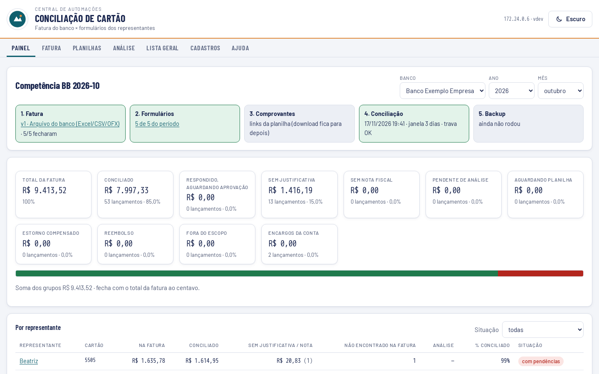
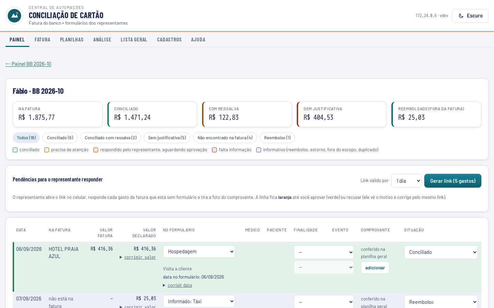
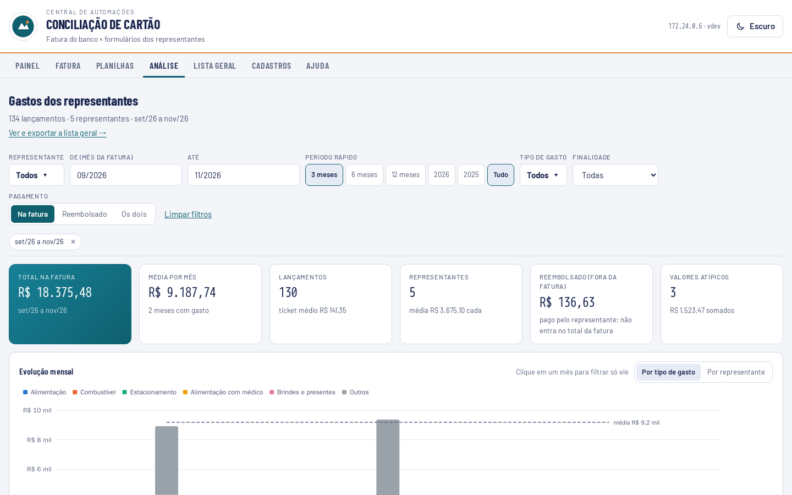

# Conciliação de cartão corporativo

[](https://github.com/gustavo-koerich/conciliacao-cartao/actions/workflows/testes.yml)

Sistema web que confere, lançamento a lançamento, a **fatura do cartão corporativo** contra o que cada representante comercial declarou nos **formulários de despesa**, e cuida das pendências até o fechamento. Substituiu uma conferência manual em planilhas que levava dias por mês.

> Repositório de portfólio. Empresa, pessoas, cartões e valores da demonstração são **fictícios**.



## O que faz

1. **Lê a fatura** do banco em PDF (camada de texto ou OCR com Tesseract) ou em Excel. Antes de aceitar, confere a fatura **ao centavo**: cada seção tem de bater com o subtotal impresso e a soma geral com o total. Uma fatura impressa da web ou incompleta é recusada.
2. **Importa os formulários** (Google Forms/planilha geral), normaliza nomes, categorias e valores digitados de formas diferentes ("1.180.00", "1,180.00") e distribui por competência.
3. **Concilia** com um motor de regras por cartão e período:
   - janela de datas;
   - compras parceladas e contas divididas;
   - estornos;
   - lançamentos entre meses;
   - divergência de valor;
   - categoria do estabelecimento × categoria declarada.
4. **Fecha a conta**: cada lançamento cai num grupo (conciliado, com ressalva, sem justificativa, reembolso…) e a soma dos grupos fecha com o total da fatura.
5. **Pendências pelo celular**: gera um link pessoal e temporário para o representante justificar cada gasto e mandar a foto do comprovante. O financeiro aprova ou recusa.
6. **Notas fiscais e controle de compras**: casa as notas com os lançamentos.
7. **Análise**: dashboard de gastos por representante, tipo e finalidade, com detecção de valores atípicos e exportação para Excel e Power BI.

| | |
|---|---|
|  |  |

## Destaques técnicos

- **Imutabilidade e auditoria**: cada importação vira uma versão (a anterior fica inativa, nunca é apagada). Cada execução do motor guarda seus resultados, e correções manuais ficam registradas com quem fez e quando.
- **Processamento assíncrono**: leitura de PDF/OCR e conciliação rodam em fila (RQ + Redis), fora da requisição web.
- **Acesso**:
  - três modos: login da Central de Automações via cookie verificado, filtro por rede ou login próprio do Django;
  - `X-Forwarded-For` só é aceito vindo de proxies confiáveis;
  - o portal de pendências roda numa porta separada, com token por representante e expiração.
- **Banco com dois usuários**: um para a aplicação e outro somente leitura para o Power BI. Há backup diário com teste de restauração.
- **287 testes automatizados** (pytest + pytest-django) cobrindo leitura de fatura, motor, telas e acesso.

## Rodando a demonstração

Requer Docker.

```bash
cp .env.example .env
# no .env: DJANGO_DEBUG=true, ACESSO_MODO=rede, PREFIXO_URL= (vazio) e uma DJANGO_SECRET_KEY qualquer
docker compose up -d --build
docker compose exec web python manage.py carregar_demo
```

Abra http://127.0.0.1:8091.

O `carregar_demo` faz o seguinte:

- gera duas faturas e a planilha de formulários no formato real, com dados fictícios;
- passa tudo pelos mesmos importadores e pelo mesmo motor da produção;
- deixa de propósito alguns formulários faltando e alguns valores digitados errados, para as pendências aparecerem.

## Testes

```bash
docker compose run --rm -e LOG_DIR=/tmp/logs-teste web pytest
```

Alguns testes usam faturas reais, que ficam fora do Git. Sem esses arquivos, eles são pulados automaticamente.

## Stack

Python 3.12 · Django 5.2 · HTMX · pandas · pdfplumber · Tesseract OCR · PostgreSQL 16 · RQ/Redis · ECharts · Docker Compose

## Estrutura

```
conciliacao/
  fatura/        leitura das faturas (PDF/OCR/Excel) e trava de conferência
  planilha/      importação e normalização dos formulários
  motor.py       regras de conciliação
  analise.py     dashboard e lista geral
  views_*.py     telas (painel, representante, cadastros, notas, portal de pendências)
config/          settings do Django
docker/          backup e inicialização do banco
tests/           pytest
```

## Licença

Código disponibilizado publicamente para fins de portfólio e demonstração técnica. Todos os direitos reservados.
